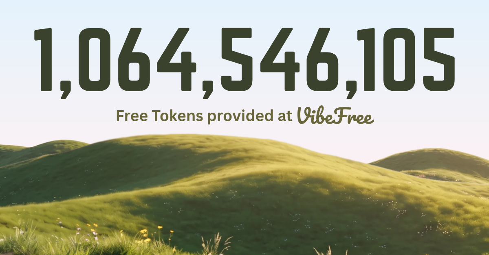

  <picture>
    <source media="(prefers-color-scheme: dark)" srcset="./assets/name-dark.svg">
    
  </picture>

<h3 align="center">Programmer & Entrepreneur · Founder & CEO of <a href="https://taptappay.co.uk">TapTapPay Ltd</a></h3>

  <em>"It's not just code, it's an experience."</em>

  
  
  

---

### About me

I enjoy building, not only for personal gain but to make a real difference. My personal goal is to give people the best user interfaces and experiences I can.

> Programming isn't just about building and shipping. It's about providing meaning behind what you build.

- 🏢 **Founder & CEO, [TapTapPay Ltd](https://taptappay.co.uk)** (2024 to present). I run product strategy, UI/UX architecture, commercial partnerships and operations. We build payment infrastructure and unattended kiosks for charities and institutions.
- 🎓 Studying **Computer Science at Lancaster University**
- 🌱 Started at 14 with Scratch and Roblox Studio, and never stopped building

### What I'm building

| Project | Description |
| --- | --- |
| **[VibeFree](https://vibefree.dev)** · AI | Free AI chat and agentic coding for everyone, funded by ethical developer ads instead of a subscription. Includes a full VS Code extension with inline diffs, command execution, MCP servers and a self-serve ad marketplace. Runs under TapTapPay Ltd. |
| **[TapTapPay](https://taptappay.co.uk)** · Fintech | A multi-platform donation system for charities, with transaction and analytics tools. Built on SumUp card readers, Kotlin/Java mobile apps and Firebase. |
| **[CodeArena](https://rayhaan-patel.com/codearena)** · Competitive programming | A gamified coding arena with 1v1 ranked ELO duels, an AI tutor and Zen practice. Code is graded in Python, TypeScript, C++, Rust, Java and Go. Real-time play runs on Socket.io, and a classroom edition is planned for UK GCSE and A-Level teachers. |
| **[Lily](https://rayhaan-patel.com/Lily)** · AI agent | A local-first AI with hybrid inference, long-term memory based on embeddings, and bring-your-own-key OpenRouter support. No servers and no data harvesting. |
| **[Dapp](https://rayhaan-patel.com/dapp)** · Social | "Connect with Purpose." A React Native social app built around real connections: chat unlocks after you dap, plus a global heatmap, live events and group daps. |
| **Jarvis** · AI agent | An autonomous AI agent that controls your computer and carries out complex multi-step tasks for you. |

  

### Tech stack

  
   
  

**Areas I focus on:** full-stack development · UI design · infrastructure · large-scale events · business operations

### GitHub stats

  
  

